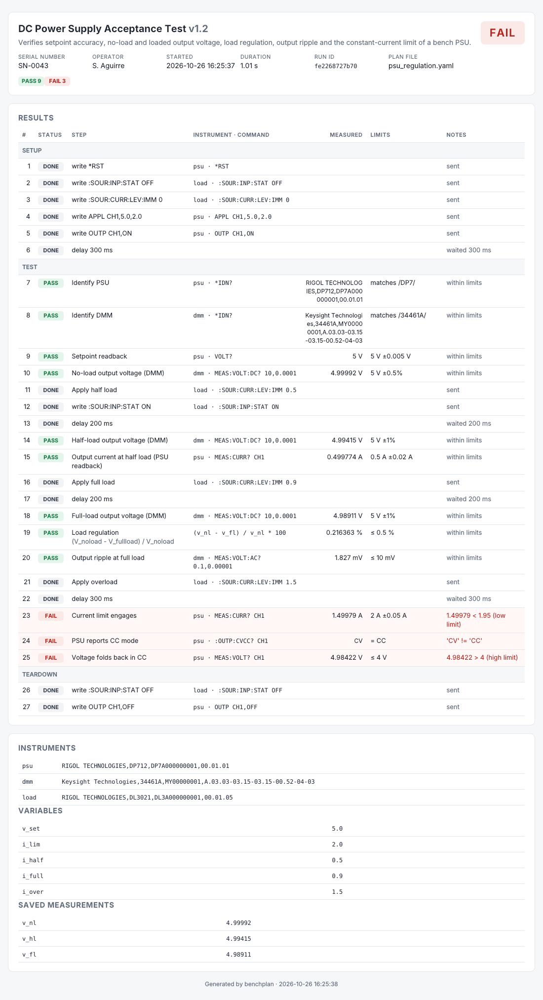

# benchplan

**YAML test plans for SCPI instruments — run them, judge every measurement against limits, and get an HTML / JSON / CSV report with serial-number traceability.**

A lightweight test sequencer for production and lab benches. Describe the test in a YAML file, point it at your instruments (any PyVISA resource: LAN, USB-TMC, GPIB, serial), and run:

```
$ benchplan run psu_regulation.yaml --serial SN-0042 --operator seb
[PASS]  Setpoint readback                      5 V          (5 V ±0.005 V)
[PASS]  No-load output voltage (DMM)           4.99992 V    (5 V ±0.5%)
[PASS]  Load regulation                        0.216363 %   (≤ 0.5 %)
[FAIL]  Current limit engages                  1.49979 A    (2 A ±0.05 A)  -- 1.49979 < 1.95 (low limit)
...
RESULT: FAIL   pass=9 fail=3 error=0 skip=0   (1.01 s)
report: benchplan-results/dc-power-supply-acceptance-test_SN-0042_20261026-162537.html
```



## Why

* **No LabVIEW / TestStand license.** Plain Python 3.9+ and one YAML file per test. Runs on the Windows PC already sitting on the bench, on a Raspberry Pi, or in CI.
* **Limits are data, not code.** `min`/`max`, `nominal ± tol`, `± %`, exact match, regex. Limits can reference plan variables and earlier measurements (`max: "v_set * 0.8"`).
* **Derived measurements.** `expr: "(v_nl - v_fl) / v_nl * 100"` — load regulation, efficiency, ratios, deltas — judged like any other step.
* **Develop without hardware.** Instruments can be *simulated inside the plan file* (stateful, with noise), so a plan can be written, demoed and unit-tested before the DUT or the instruments exist.
* **Traceable output.** Every run writes a self-contained HTML report, a JSON record and appends one row per step to a long-format `results.csv` (run id, serial, operator, timestamp, value, limits, status). Exit code = PASS/FAIL/ERROR, so it drops into any fixture controller or CI job.
* **Retries, abort-on-fail, skip conditions, setup/teardown** that always runs — the things real benches need.

## Install

```bash
pip install .                # core (PyYAML only) — simulated instruments work out of the box
pip install ".[visa]"        # + PyVISA and the pure-Python pyvisa-py backend for real instruments
```

Real instruments need a VISA backend: `pyvisa-py` (pure Python, LAN/USB/serial) is installed by the `[visa]` extra; NI-VISA or Keysight IO Libraries also work if already installed.

## 60-second demo (no hardware)

```bash
benchplan demo                         # bundled PSU acceptance test, 3 simulated instruments -> PASS
benchplan demo --var i_lim=2.0         # same plan with the current limit never engaging -> FAIL
benchplan example > my_test.yaml       # copy the example as a starting point
benchplan validate my_test.yaml        # check a plan without running it
benchplan resources                    # list VISA resources visible to PyVISA
```

Reports land in `./benchplan-results/` (change with `--out`).

## Writing a plan

```yaml
name: DC Power Supply Acceptance Test
version: "1.2"
on_fail: continue                 # or abort: stop at the first FAIL/ERROR (teardown still runs)

variables:                        # usable as {name} in commands and as names in expressions
  v_set: 5.0
  i_lim: 1.0

instruments:
  psu:
    resource: TCPIP0::192.168.1.20::inst0::INSTR     # any VISA resource string, or sim://name
    timeout_ms: 5000
    check_errors: true            # query SYST:ERR? after each write and fail the step on an error
  dmm: USB0::0x2A8D::0x1301::MY00000001::INSTR       # short form

setup:                            # runs first; a failure here is an ERROR
  - {instrument: psu, write: "*RST"}
  - {instrument: psu, write: "APPL CH1,{v_set},{i_lim}"}
  - {instrument: psu, write: "OUTP CH1,ON"}
  - {delay_ms: 300}

steps:
  - name: Identify PSU
    instrument: psu
    query: "*IDN?"
    parse: str
    limits: {regex: "DP7"}

  - name: No-load output voltage
    instrument: dmm
    query: "MEAS:VOLT:DC? 10,0.0001"
    units: V
    limits: {nominal: "{v_set}", tol_pct: 0.5}
    save_as: v_nl                 # becomes available to later expressions
    retries: 1                    # re-measure once if it fails

  - name: Output ripple
    instrument: dmm
    query: "MEAS:VOLT:AC?"
    scale: 1000                   # V -> mV
    units: mV
    limits: {max: 10}

  - name: Load regulation
    expr: "(v_nl - v_fl) / v_nl * 100"
    units: "%"
    limits: {max: 0.5}

  - name: Skipped on quick runs
    instrument: dmm
    query: "MEAS:VOLT:DC?"
    skip_if: "quick"              # any expression over variables/measurements
    limits: {min: 0}

teardown:                         # always runs, even after abort or an instrument error
  - {instrument: psu, write: "OUTP CH1,OFF"}
```

### Step reference

| key | meaning |
|---|---|
| `name` | Step title (optional for write/delay steps; auto-generated from the command). |
| `instrument` | Alias from `instruments`. Required for `write`/`query`. |
| `write` / `query` / `expr` / `delay_ms` | Exactly one per step. `{placeholders}` are substituted from variables and saved measurements. |
| `parse` | `auto` (number if possible, else text), `float`, `int`, `str`, `bool` (`1/ON/TRUE/YES`). |
| `scale` | Multiply numeric results (unit conversion). |
| `units` | Shown next to values and limits. |
| `limits` | `min`, `max`, `nominal` + `tol` (absolute) or `tol_pct` (%), `equals`, `one_of`, `regex`. Values may be numbers, `{placeholders}` or expressions. A step without limits is recorded as INFO. |
| `save_as` | Store the value under this name for later `expr`/limits/placeholders. |
| `retries`, `retry_delay_ms` | Repeat a failing/erroring step before giving up. |
| `on_fail` | Per-step override of the plan-level `continue`/`abort`. |
| `skip_if` | Expression; when true the step is SKIPped. |
| `note` | Free text shown in the report. |

Expressions are evaluated by a small sandboxed evaluator: arithmetic, comparisons, `and/or/not`, conditional expressions, and `abs min max round sqrt log log10 exp pow floor ceil sin cos tan atan2 hypot mean sum` plus `pi` and `e`. No attribute access, no imports.

### Instrument reference

| key | default | meaning |
|---|---|---|
| `resource` | – | VISA resource string, or `sim://name` for a simulated instrument. |
| `timeout_ms` | 5000 | I/O timeout. |
| `read_termination`, `write_termination` | `"\n"` | Use `"\r\n"` for many serial instruments. |
| `query_delay` | 0 | Seconds between write and read of a query (slow serial instruments). |
| `check_errors` | false | Query `SYST:ERR?` after every write; a non-zero error fails the step. |
| `visa_library` | (default) | e.g. `"@py"` to force pyvisa-py, or a path to a VISA DLL. |
| `sim` | – | Simulation block, see below. |

### Simulated instruments

Any instrument with `resource: sim://...` is answered in-process by rules in its `sim` block. State is kept per instrument, or shared across instruments with the same `state_group` (so a simulated PSU, DMM and electronic load can agree on what the "bench" is doing):

```yaml
sim:
  state_group: bench
  seed: 7                                  # reproducible noise
  state: {v_set: 0.0, out: 0, load_i: 0.0}
  derived:                                 # recomputed before each response
    v_out: "v_set - 0.012 * load_i if out else 0.0"
  commands:                                # regex (case-insensitive, full match) -> rule
    'VOLT (?P<v>[-\d.]+)':  {set: {v_set: "v"}}          # named groups become variables
    'OUTP (?P<s>ON|OFF)':   {set: {out: "1 if s == 'ON' else 0"}}
    'VOLT\?':               {response: "v_set"}
    'MEAS:VOLT\?':          {response: "v_out + gauss(0, 0.002)"}
    '\*IDN\?':              "ACME,PSU-1,0001,1.0"        # plain strings are format strings: "{v_set}"
```

`*IDN?`, `*RST` (restores the initial state), `*CLS`, `*OPC?` and `SYST:ERR?` have built-in defaults. Unknown writes are accepted silently; unknown queries raise an ERROR for the step.

## Python API

```python
from benchplan import load_plan, run_plan, write_all

plan = load_plan("psu_regulation.yaml")
result = run_plan(plan, serial="SN-0042", operator="seb", variables={"v_set": 12.0})
print(result.status, result.counts)            # 'PASS' {'PASS': 12, 'FAIL': 0, ...}
for step in result.tests:
    print(step.name, step.status, step.value, step.units, step.limits, step.message)
paths = write_all(result, "reports", plan.slug)   # {'html': ..., 'json': ..., 'csv': ...}
```

`Runner(plan, on_step=callback)` streams `StepResult`s as they complete — handy for a GUI or a fixture PLC. `Runner(plan, open_fn=my_factory)` lets you plug in your own instrument classes (anything with `write()`/`query()`/`close()`).

## Outputs

* `<plan>_<serial>_<timestamp>.html` – self-contained report (no external assets, prints cleanly).
* `<plan>_<serial>_<timestamp>.json` – full machine-readable record (steps, raw responses, limits, variables, instrument IDNs).
* `results.csv` – appended on every run, one row per step; load it straight into Excel, pandas or a database for yield and trend analysis.

Exit codes: `0` PASS · `1` FAIL · `2` ERROR (instrument/communication problem) · `3` invalid plan.

## Tests

```bash
pip install ".[dev]"
pytest
```

65 tests cover the expression sandbox, limit logic, plan validation, the runner (retries, abort, skip, placeholders, derived steps), report writers and the CLI, including a round-trip through PyVISA's `pyvisa-sim` backend.

## Roadmap

* Serial-number input from a barcode scanner (keyboard wedge) in the CLI.
* Per-instrument driver modules (Rigol DP700/DL3000, Keysight 3446x/E36xx, Siglent) with typed helpers.
* Optional PDF export of the HTML report.
* Yield summary across `results.csv`.

## License

MIT.
